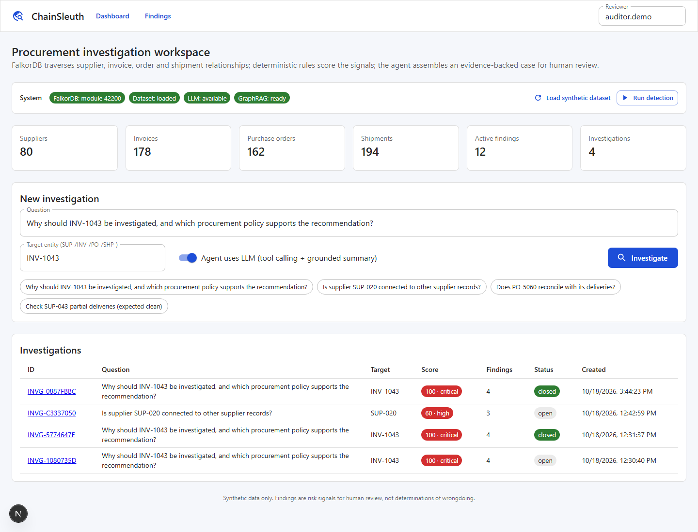
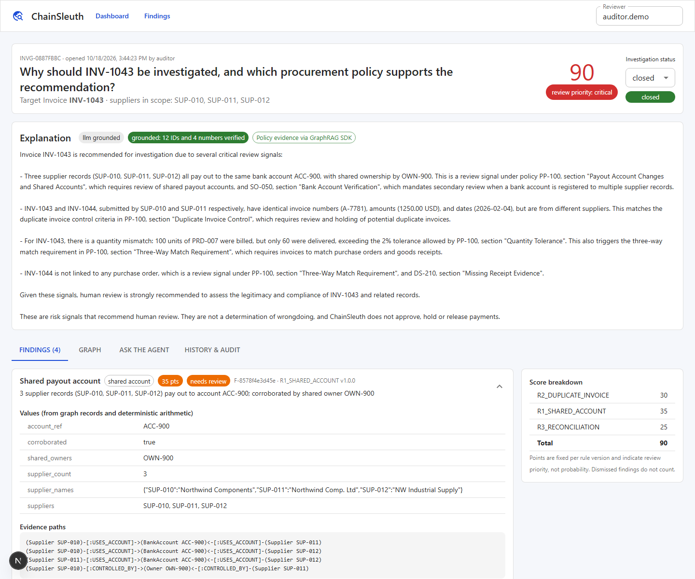
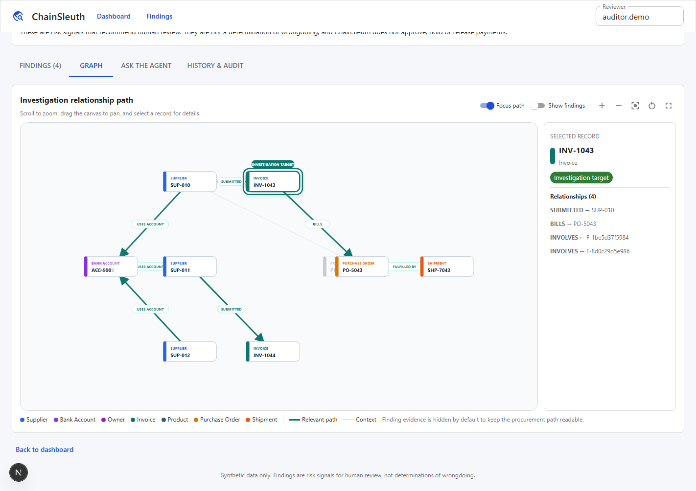
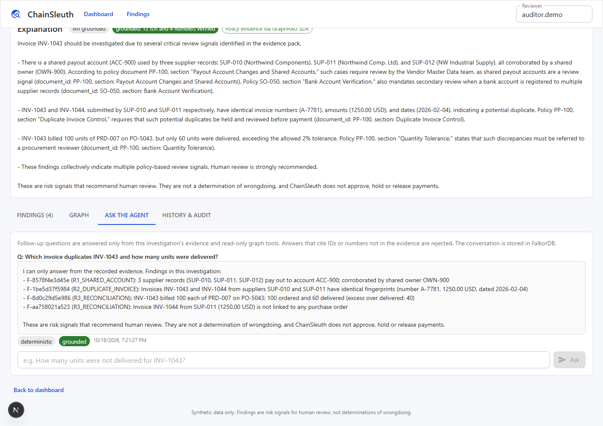
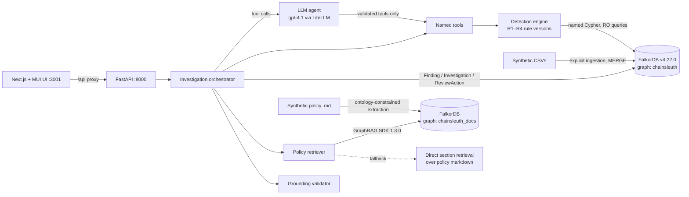

# ChainSleuth

**An explainable procurement-anomaly investigation agent built on FalkorDB.**

[](LICENSE)

Graph Hacks 2026 · Primary track: **Agents That Act on Connected Data**

An auditor picks an invoice, supplier, purchase order or shipment, or asks a question about one. ChainSleuth then:

1. traverses the procurement graph in **FalkorDB** to find the connected suppliers, invoices, orders and shipments;
2. runs **deterministic, versioned detection rules** written as reviewed Cypher queries plus plain arithmetic;
3. **persists** findings, evidence paths, rule versions and scores as graph nodes;
4. retrieves supporting **policy passages through the FalkorDB GraphRAG SDK**, keeping verified source provenance;
5. writes an **explanation that a validator checks**: every record ID and number in it must appear in the retrieved evidence;
6. keeps **reviewer decisions** and investigation history in the graph, so later sessions build on earlier ones.

> ChainSleuth reports **risk signals for human review**. It does not determine wrongdoing, and it does not approve, hold or release payments. All data in this repository is synthetic.

---

## Contents
- [Screenshots](#screenshots)
- [Architecture](#architecture)
- [Pinned versions](#pinned-versions)
- [Quick start (local)](#quick-start-local)
- [Demo walkthrough](#demo-walkthrough)
- [Graph data model](#graph-data-model)
- [Detection rules and Cypher](#detection-rules-and-cypher)
- [Scoring](#scoring)
- [GraphRAG policy evidence](#graphrag-policy-evidence)
- [Agent and grounding](#agent-and-grounding)
- [Tests and measured results](#tests-and-measured-results)
- [Version compatibility findings](#version-compatibility-findings)
- [Limitations](#limitations)
- [Repository layout](#repository-layout)
- [License](#license)

## Screenshots

### Investigation dashboard



### Grounded investigation



### Highlighted graph path



### Evidence-grounded agent follow-up



## Architecture



| Component | Responsibility |
|---|---|
| **FalkorDB `chainsleuth` graph** | The authoritative procurement facts, plus the persisted findings, investigations, rule versions, reviewer actions and agent turns. All detection traversals run here. |
| **FalkorDB `chainsleuth_docs` graph** | Created by the GraphRAG SDK: `Document`, `Chunk` and `__Entity__` nodes extracted from the synthetic policies. It is kept apart so that extracted claims can never overwrite transaction data. |
| **Detection engine** (`app/detection`) | Four rules. Each one runs named Cypher queries and then plain Python arithmetic. No LLM is involved. |
| **Orchestrator** (`app/agent/orchestrator.py`) | Lets the LLM agent choose among validated tools. Regardless of what the agent does, the orchestrator guarantees that the investigation is persisted, that policy evidence is attached, and that the explanation passes grounding. |
| **Grounding validator** (`app/agent/grounding.py`) | Rejects any generated text that contains IDs or numbers missing from the evidence, or that uses wording such as "fraud", "proof" or "blocked payment". |

The same tools run in a fixed, deterministic order when no LLM key is configured, so the product works fully offline. Only the GraphRAG path and the natural-language explanation need the key.

## Pinned versions

Every version below was tested together by the automated suite in this repository.

| Layer | Package / image | Version |
|---|---|---|
| Graph database | `falkordb/falkordb` | **v4.22.0** (see [compatibility](#version-compatibility-findings)) |
| Python client | `FalkorDB` | 1.7.1 |
| GraphRAG | `graphrag-sdk` | 1.3.0 (installed with `--no-deps`, see below) |
| LLM / embeddings | `litellm` 1.104.1 → `openai/gpt-4.1`, `openai/text-embedding-3-large` (256 dims) | |
| API | Python 3.10, `fastapi` 0.142.4, `uvicorn` 0.54.0 | |
| UI | `next` 15.5.27, `react` 19.3.0, `@mui/material` 6.5.0 | |

Python dependencies were resolved with `pip --uploaded-prior-to 2026-10-08`, and npm dependencies with `--before=2026-10-08`. Every package in the stack had therefore been public for at least a week. The complete transitive set is recorded in `backend/requirements.lock.txt` and `frontend/package-lock.json`.

`graphrag-sdk` 1.3.0 lists `hnswlib` and `gliner` as hard dependencies, but it imports them lazily, and only inside optional strategies that ChainSleuth does not use (semantic resolution and the GLiNER extractor). `hnswlib` has no Windows wheel, and `gliner` pulls in PyTorch, so the SDK is installed with `--no-deps` on top of its remaining real dependencies. The GraphRAG gate test (`tests/test_graphrag.py`) confirms that this setup ingests and retrieves correctly.

## Quick start (local)

Prerequisites: Docker, Python 3.10+, Node 20+. An OpenAI API key is optional. Without one, the deterministic agent and the direct document-retrieval fallback are used.

```bash
# 1. FalkorDB (server on :6379, FalkorDB Browser on :3000)
docker compose up -d

# 2. Backend
cd backend
python -m venv .venv
# Windows: .venv\Scripts\activate     macOS/Linux: source .venv/bin/activate
python -m pip install -r requirements.lock.txt
python -m pip install --no-deps -r requirements-graphrag.txt
# macOS/Linux: cp .env.example .env
# PowerShell: Copy-Item .env.example .env
# Optionally set OPENAI_API_KEY in .env

# 3. Synthetic data -> FalkorDB (explicit CSV ingestion, then integrity validation)
python -m data.generate_synthetic
python -m app.graph.ingest --reset
python -c "from app.graph.integrity import validate_graph; print(validate_graph()['ok'])"

# 4. (needs OPENAI_API_KEY) ingest the policy documents with the GraphRAG SDK
python -m app.graphrag.ingest_documents --reset

# 5. API
uvicorn app.main:app --port 8000

# 6. UI (new terminal, from the repository root)
cd frontend
npm ci
npm run dev                     # http://localhost:3001
```

### Verify the installation

With FalkorDB running, execute:

```bash
# Backend, from backend/
python -m pytest -q

# Frontend, from frontend/
npm run typecheck
npm run build
```

The expected backend result is `73 passed`; live LLM tests skip automatically when no key is configured. The frontend build must run while `npm run dev` is stopped because both commands write to `.next`. If a previous process was interrupted and Next.js reports a missing generated chunk, stop the dev server, remove `frontend/.next`, and restart it.

The tests use isolated graphs (`chainsleuth_test` and `chainsleuth_docs_gate_test`) and do not modify the demo graph. `graphrag-sdk` intentionally reports `gliner` and `hnswlib` as absent under `pip check`; ChainSleuth does not use those optional strategies, and the live GraphRAG gate test verifies the supported installation path.

## Demo walkthrough

1. Open http://localhost:3001. The system bar shows the FalkorDB module version (`42200`), the dataset status, and whether the LLM and GraphRAG are available.
2. Click **Run detection**. 12 findings are persisted. Running it again creates no new findings.
3. Start the suggested investigation: *"Why should INV-1043 be investigated, and which procurement policy supports the recommendation?"*
   - **R1 shared account.** `SUP-010`, `SUP-011` and `SUP-012` all pay out to `ACC-900`, and `SUP-010`/`SUP-011` share owner `OWN-900` (35 points).
   - **R2 exact duplicate.** `INV-1044` from `SUP-011` repeats invoice `A-7781` (1250.00 USD, dated 2026-02-04) from `INV-1043` (30 points).
   - **R3 quantity mismatch.** `INV-1043` bills 100 units of `PRD-007` on `PO-5043`. 100 were ordered and 60 delivered (`SHP-7043`), an excess of 40 (25 points).
   - **R3 unresolved PO link.** `INV-1044` has no purchase order (10 points).
   - The score is 100 (critical review priority). Each finding is shown with its evidence paths, the named query that reproduces it, and the GraphRAG policy passages that support it (PP-100 *Quantity Tolerance*, *Duplicate Invoice Control*, and so on).
4. Open the **Graph** tab. The view centers and zooms to the highlighted operational path from `INV-1043` through its suppliers and shared account `ACC-900`, then to `PO-5043` and `SHP-7043`. Scroll to zoom, drag to pan, click a node to inspect its relationships, or use **Fit path**, **Focus path**, and fullscreen mode. Finding nodes are hidden by default to keep the procurement path readable and can be restored with **Show findings**.
5. Record reviewer decisions: confirm the quantity mismatch and dismiss the duplicate. The score is recomputed (dismissed findings stop counting).
6. Open **Ask the agent** and try *"Which invoice duplicates INV-1043 and does it have a purchase order?"*. Answers are grounded and stored as `AgentTurn` nodes.
7. Restart the API or open a new browser session, then reopen the investigation. Reviewer state, explanation and conversation are all reloaded from FalkorDB.
8. Investigate **SUP-020**, then investigate it again and ask *"what changed since we last looked?"*. The agent calls `compare_with_previous`, which follows the `FOLLOWED_BY` chain.
9. For a clean case, investigate **SUP-043**. Its partial deliveries are invoiced correctly, so it produces no findings and a score of 0.

## Graph data model

### Operational graph (`chainsleuth`)

| Node | Key | Properties |
|---|---|---|
| `Supplier` | `supplier_id` | name, status, created_at |
| `BankAccount` | `account_ref` | bank_code, account_status, **registered_intermediary** |
| `Owner` | `owner_id` | name |
| `Invoice` | `invoice_id` | invoice_number, amount, currency, invoice_date, status, **fingerprint** |
| `InvoiceLine` | `line_id` | quantity, unit, unit_price |
| `PurchaseOrder` | `po_id` | ordered_at, status |
| `POLine` | `po_line_id` | quantity, unit, unit_price |
| `Shipment` | `shipment_id` | status (`delivered` / `in_transit` / `cancelled`), shipped_at |
| `ShipmentLine` | `shipment_line_id` | quantity, unit |
| `Warehouse` | `warehouse_id` | name, region |
| `Payment` | `payment_id` | amount, currency, paid_at, status |
| `Product` | `product_id` | name, unit, list_price |

Every operational node carries `source_file`, which records where the fact came from.

```
(Supplier)-[:USES_ACCOUNT]->(BankAccount)
(Supplier)-[:CONTROLLED_BY]->(Owner)
(Supplier)-[:SUBMITTED]->(Invoice)-[:BILLS]->(PurchaseOrder)
(Supplier)-[:RECEIVED_PO]->(PurchaseOrder)
(Invoice)-[:HAS_LINE]->(InvoiceLine)-[:BILLS_PRODUCT]->(Product)
(PurchaseOrder)-[:HAS_LINE]->(POLine)-[:ORDERS_PRODUCT]->(Product)
(PurchaseOrder)-[:FULFILLED_BY]->(Shipment)-[:HAS_LINE]->(ShipmentLine)-[:SHIPS_PRODUCT]->(Product)
(Shipment)-[:ROUTE_STOP {sequence}]->(Warehouse)
(Warehouse)-[:APPROVED_NEXT]->(Warehouse)
(Invoice)-[:SETTLED_BY]->(Payment)-[:PAID_TO]->(Supplier)
```

### Investigation layer (same graph)

| Node | Purpose |
|---|---|
| `DetectionRule {rule_key: "R3_RECONCILIATION@1.0.0"}` | rule id, version, description, scoring config, query names |
| `DetectionRun` | run id, timestamp, per-rule timings |
| `Finding` | `finding_id` (stable hash of rule and subject), rule_id, rule_version, subject_key, category, score, severity, status, created_at, last_evaluated_at, dataset_version, evidence_summary, values, record IDs, evidence_paths, reproducing query, active |
| `Investigation` | question, target, status, score, scope, explanation, explanation mode, grounding report, policy status, tool trace |
| `ReviewAction` | decision, reviewer, note, previous status, timestamp |
| `EvidenceChunk` | policy passage copied in with document id, section, source path and retrieval method |
| `AgentTurn` | follow-up question, answer, grounding flag, tool trace |

```
(Finding)-[:TRIGGERED_BY]->(DetectionRule)
(Finding)-[:INVOLVES]->(Supplier | Invoice | PurchaseOrder | Shipment | BankAccount | Owner | Product | Warehouse)
(Finding)-[:SUPPORTED_BY]->(EvidenceChunk)
(Finding)-[:RELATED_TO]->(Finding)          // share an Invoice, BankAccount or PurchaseOrder
(Finding)-[:HAS_REVIEW]->(ReviewAction)
(DetectionRun)-[:PRODUCED]->(Finding)
(Investigation)-[:FOCUSES_ON]->(target)
(Investigation)-[:CONTAINS]->(Finding)
(Investigation)-[:FOLLOWED_BY]->(Investigation)
(Investigation)-[:HAS_TURN]->(AgentTurn)
```

Kinds of information are kept apart. **Observed facts** come from the CSVs. **Extracted claims** live only in the docs graph. **Derived signals** are `Finding` nodes. **Reviewer decisions** are `ReviewAction` nodes and `Finding.status`. The evaluation labels (`backend/data/ground_truth.csv`) are never loaded into any graph, and a test enforces this.

## Detection rules and Cypher

All Cypher lives in one registry, `backend/app/graph/queries.py`, and is executed **by name** with parameters through `GRAPH.RO_QUERY`. No endpoint or tool accepts Cypher. Unknown query names and unexpected parameters are rejected (tested).

**R1 — shared payout account (v1.0.0).** Accounts flagged `registered_intermediary` (factoring agents) are excluded by rule configuration.
```cypher
MATCH (s1:Supplier)-[:USES_ACCOUNT]->(a:BankAccount)<-[:USES_ACCOUNT]-(s2:Supplier)
WHERE s1.supplier_id < s2.supplier_id
  AND ($supplier_id IS NULL OR s1.supplier_id = $supplier_id OR s2.supplier_id = $supplier_id)
OPTIONAL MATCH (s1)-[:CONTROLLED_BY]->(o:Owner)<-[:CONTROLLED_BY]-(s2)
RETURN a.account_ref AS account_ref, a.registered_intermediary AS registered_intermediary,
       s1.supplier_id AS supplier_a, s2.supplier_id AS supplier_b, collect(DISTINCT o.owner_id) AS shared_owners
```

**R2 — exact duplicate invoice (v1.0.0).** The fingerprint is a SHA-256 hash computed at ingestion over the normalized invoice number, amount, currency, date and line items. It deliberately **excludes the supplier**, so the same invoice submitted under two supplier records still collides.
```cypher
MATCH (i1:Invoice), (i2:Invoice)
WHERE i2.fingerprint = i1.fingerprint AND i1.invoice_id < i2.invoice_id
WITH i1, i2
MATCH (s1:Supplier)-[:SUBMITTED]->(i1)
MATCH (s2:Supplier)-[:SUBMITTED]->(i2)
OPTIONAL MATCH (s1)-[:USES_ACCOUNT]->(a:BankAccount)<-[:USES_ACCOUNT]-(s2) WHERE s1 <> s2
RETURN i1.invoice_id AS invoice_a, i2.invoice_id AS invoice_b, s1.supplier_id AS supplier_a,
       s2.supplier_id AS supplier_b, i1.fingerprint AS fingerprint, collect(DISTINCT a.account_ref) AS shared_accounts
```

**R3 — product-level reconciliation (v1.0.0).** Three traversals (billed, ordered, shipped lines per PO and product) plus a query for invoices with no PO. The arithmetic runs in `reconciliation.classify()` and has its own unit tests. Only `delivered` shipments count as receipt evidence, cumulative partial deliveries are summed, units must match, and the tolerance is 2 %.
```cypher
MATCH (s:Supplier)-[:SUBMITTED]->(i:Invoice)-[:BILLS]->(po:PurchaseOrder)
WHERE $po_ids IS NULL OR po.po_id IN $po_ids
MATCH (i)-[:HAS_LINE]->(il:InvoiceLine)-[:BILLS_PRODUCT]->(p:Product)
RETURN po.po_id AS po_id, i.invoice_id AS invoice_id, il.line_id AS line_id,
       p.product_id AS product_id, il.quantity AS quantity, il.unit AS unit

MATCH (po:PurchaseOrder)-[:FULFILLED_BY]->(sh:Shipment)
WHERE $po_ids IS NULL OR po.po_id IN $po_ids
MATCH (sh)-[:HAS_LINE]->(sl:ShipmentLine)-[:SHIPS_PRODUCT]->(p:Product)
RETURN po.po_id AS po_id, sh.shipment_id AS shipment_id, sh.status AS shipment_status,
       p.product_id AS product_id, sl.quantity AS quantity, sl.unit AS unit
```
Output categories: `quantity_mismatch`, `missing_shipment_evidence`, `unit_mismatch`, `unresolved_purchase_order_link`.

**R4 — unapproved warehouse transition (v1.0.0).**
```cypher
MATCH (sh:Shipment)-[r1:ROUTE_STOP]->(w1:Warehouse), (sh)-[r2:ROUTE_STOP]->(w2:Warehouse)
WHERE r2.sequence = r1.sequence + 1
OPTIONAL MATCH (w1)-[ap:APPROVED_NEXT]->(w2)
WITH sh, r1, r2, w1, w2, ap WHERE ap IS NULL
MATCH (po:PurchaseOrder)-[:FULFILLED_BY]->(sh)
RETURN sh.shipment_id, po.po_id, r1.sequence, r2.sequence, w1.warehouse_id AS origin, w2.warehouse_id AS destination
```

**Investigation scope.** From the target, the investigation walks to its supplier, then to suppliers linked by a shared non-intermediary account or a shared owner, then to their invoices, POs and shipments. It then collects the active findings that `INVOLVES` any of those records (`supplier_network`, `supplier_activity`, `findings_in_scope`).

## Scoring

| Signal | Points (rule v1.0.0) |
|---|---|
| Shared payout account | 20 |
| … corroborated by a shared owner | +15 |
| Exact duplicate invoice | 30 |
| Quantity mismatch | 25 |
| Missing delivery evidence | 15 |
| Unit mismatch | 10 |
| Invoice without PO | 10 |
| Unapproved route transition | 15 |

The investigation score is the sum over **distinct** findings (deduplicated by `finding_id`), capped at 100. Dismissed findings are excluded. Severity bands are low < 25 ≤ medium < 50 ≤ high < 75 ≤ critical. These weights are engineering choices that express **review priority**. They are not calibrated probabilities. `confirmed` is set only by a reviewer, never automatically.

## GraphRAG policy evidence

Five synthetic documents live in `backend/data/policies/`: a procurement policy, a delivery specification, a supplier onboarding checklist, a warehouse routing policy, and an incident review.

- **Ingestion** (`python -m app.graphrag.ingest_documents`) uses the SDK with an explicit `Ontology` (Policy, Control, Threshold, RiskSignal, Role, RecordType), LLM extraction, and a chunker that splits **one chunk per markdown section**. The result is 23 chunks and 88 entities, written to `chainsleuth_docs`, with the ontology kept in the SDK's companion graph `chainsleuth_docs__ontology`.
- **Retrieval** calls `GraphRAG.retrieve()` (multi-path: vector, full-text, entity expansion, reranking). ChainSleuth then applies a **provenance gate**: a passage is used only if its exact text exists as a `Chunk` linked by `PART_OF` to the `Document` it cites. That chunk is then mapped to the policy's document ID and section.
- Each finding gets passages from a fixed, reviewed question for its rule, and those passages are stored as `EvidenceChunk` nodes linked by `SUPPORTED_BY`.
- **Fallback.** If the key is missing, the documents have not been ingested, or the SDK raises, a deterministic section-level TF-IDF retriever over the same markdown is used. The investigation then reports `policy_status = fallback`, and `unavailable` if nothing matches. The UI shows which path was used.

## Agent and grounding

- **Tools** (`app/agent/tools.py`): `resolve_entity`, `get_supplier_network`, `check_shared_accounts`, `check_duplicate_invoices`, `reconcile_invoice`, `check_routes`, `get_prior_investigations`, `compare_with_previous`, `search_policy`, `open_investigation`. Arguments are checked against a JSON schema and ID regexes. Only `open_investigation` writes, and follow-up Q&A runs with read-only tools.
- **Explanation.** The LLM receives the evidence pack (findings, values, record IDs, paths, policy passages) and nothing else. Its output must pass `grounding.validate()`. If it fails, the model gets one corrective retry. After that, the deterministic template explanation is used, and the rejected drafts are kept in the audit trail.
- **Grounding checks.** Every record-style ID and every number in the text must appear in the evidence. The text may not contain wording such as *fraud*, *proof*, *guilt*, *criminal*, or *blocked payment*. A fixed disclaimer is appended by code, not generated.

## Tests and measured results

`pytest` in `backend/` runs **73 tests against `falkordb/falkordb:v4.22.0`, `FalkorDB` 1.7.1 and `graphrag-sdk` 1.3.0**, including the live GraphRAG gate and a live-LLM acceptance run. All 73 pass.

| Area | Tests |
|---|---|
| Phase A | real connection, minimal graph, Cypher result |
| Ingestion | node and relationship counts vs CSV, structural orphan checks, typed properties, idempotent re-ingest, ground truth absent from the graph |
| Detection | each rule equals the planted ground truth exactly; legitimate shared intermediary account, recurring invoices and partial deliveries are not flagged; 9 reconciliation arithmetic cases (tolerance, cancelled or in-transit shipments, units, never-ordered products) |
| Persistence | required finding fields, rule edge, `INVOLVES` edges, evidence reproducible from the stored query, repeated runs idempotent, reviewer decision survives re-detection |
| Grounding | invented IDs, quantities and amounts rejected; banned wording rejected; a hallucinating model is rejected twice and falls back; invalid tool calls and injected arguments rejected |
| GraphRAG gate | pinned SDK version, ingestion creates `Document`/`Chunk`/`__Entity__`, retrieval returns provenance-verified PP-100 *Quantity Tolerance*, operational graph untouched |
| Acceptance | the full 10-step flow through the HTTP API, including a new session with reviewer state preserved and score recomputed, cross-session comparison, a clean entity, and bad input |

Measured with `CHAINSLEUTH_GRAPH=chainsleuth_eval python -m app.evaluate` on a Windows 11 laptop with Python 3.10.11 and FalkorDB v4.22.0 in Docker (`backend/data/evaluation_results.json`):

| Metric | Result |
|---|---|
| Recall (planted anomalies: R1 2, R2 2, R3 6, R4 2) | 12 / 12 = 1.0 |
| Precision | 12 / 12 = 1.0 |
| Legitimate controls flagged (intermediary account, recurring invoices, 2 partial-delivery POs) | 0 / 4 |
| Repeatability (new findings on second run) | 0, with Finding count stable at 12 |
| Explanations passing grounding (8 investigations) | 8 / 8 |
| Findings with complete evidence (rule version, values, record IDs, paths) | 11 / 11 |
| Median rule query latency | R1 2.7 ms · R2 2.0 ms · R3 49 ms · R4 4.6 ms |
| Full detection run | ~59 ms |
| Investigation, median (deterministic explanation, GraphRAG retrieval) | ~1.0 s (the first call is ~15 s for LiteLLM import and a cold connection) |

These numbers come from a small synthetic dataset whose anomalies were planted by the same team that wrote the rules. They show that the implementation is correct and repeatable. **They are not evidence of real-world detection performance.**

## Version compatibility findings

Testing against the exact pinned versions turned up three issues, all of which are now covered by tests:

1. **`graphrag-sdk` 1.3.0 is incompatible with FalkorDB 6.0.x.** The SDK creates full-text indexes with `CALL db.idx.fulltext.createNodeIndex('Chunk', 'text')`. The 6.0 Rust engine rejects this with *"Received 2 arguments … expected at most 1"*, and the SDK's circuit breaker then opens. SDK 1.4.0 contains the same call. ChainSleuth was developed on 6.0.2 at first, and the whole suite was then re-run on the 4.x C engine. **FalkorDB is pinned to v4.22.0**, where all 73 tests pass.
2. **Relationship uniqueness within a pattern is not enforced** (on both v4.22.0 and 6.0.2). One `USES_ACCOUNT` edge can bind twice, so a supplier matches itself. Every two-sided query therefore excludes self-matches explicitly (`s1.supplier_id < s2.supplier_id` or `o <> s`).
3. **On 6.0.2, `MATCH … WHERE` followed by `OPTIONAL MATCH … WHERE` dropped the first `WHERE`.** The duplicate query returned 63,368 rows instead of 2. v4.22.0 applies the filter correctly, but the queries keep a `WITH` barrier there so they behave the same on both versions.

Two SDK details also differed from what the current documentation suggested. The installed 1.3.0 API uses `Ontology`, `Entity` and `Relation` (not `GraphSchema` or `TableMapping`), and markdown ingestion requires `markdown-it-py`. In addition, the default extractor tries GLiNER first, so ChainSleuth configures `GraphExtraction(entity_extractor=LLMExtractor(...))`.

## Limitations

- The rules are deliberately simple and exact. There is no near-duplicate invoice matching, no unit-conversion table, and no fuzzy entity resolution across supplier names.
- The grounding validator checks IDs, digits and wording. It does not check numbers written as words or the semantic correctness of a sentence, so reviewers should still read the evidence panel.
- The synthetic dataset is small (80 suppliers, 178 invoices, 194 shipments). Latency at production scale has not been measured.
- The API has no authentication. It is meant for local use; do not expose FalkorDB or the API publicly without adding authentication.

## Repository layout

```
docker-compose.yml               FalkorDB v4.22.0 (pinned)
backend/
  app/graph/                     client, schema/indexes, CSV ingestion, integrity checks, named query registry
  app/detection/                 R1–R4 rules, rule registry with versions and points, engine
  app/investigations/            persistence (findings, reviews, evidence), investigation service, evidence pack
  app/graphrag/                  SDK client and ontology, document ingestion, fallback retriever, unified retriever
  app/agent/                     tools, orchestrator, LLM wrapper, explanation, grounding validator
  app/scoring.py                 capped, deduplicated scoring
  app/evaluate.py                measured evaluation
  app/main.py                    FastAPI app
  data/generate_synthetic.py     deterministic synthetic data generator (seed 42)
  data/generated/*.csv           generated dataset
  data/ground_truth.csv          evaluation labels (never loaded into the graph)
  data/policies/*.md             synthetic policy documents
  tests/                         73 tests
frontend/                        Next.js 15 + MUI 6 investigation UI
docs/screenshots/                README product screenshots
AI_USAGE.md                      disclosure of AI coding assistance
LICENSE                          MIT license
```

## Hackathon submission fields

- **Project:** ChainSleuth, an explainable procurement-anomaly investigation agent
- **Primary track:** Agents That Act on Connected Data
- **FalkorDB usage:** the primary database for every operational fact, every detection traversal (shared-account networks, invoice/order/shipment line reconciliation, route validation), the investigation scope traversal, and persistent investigation memory (findings, reviews, `FOLLOWED_BY` history, agent turns). It also hosts the GraphRAG SDK document graph.
- **Data:** fully synthetic (generator included)
- **AI assistance:** disclosed in [AI_USAGE.md](AI_USAGE.md)

## License

ChainSleuth is open source under the [MIT License](LICENSE).
